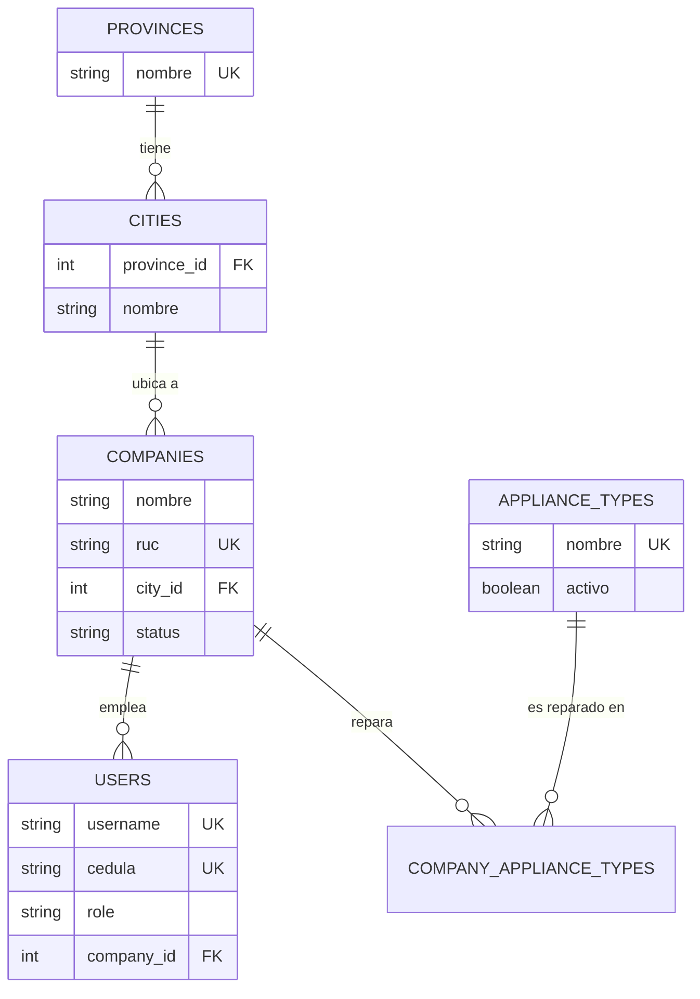

# Página Web Gabo: Administración MVC para servicios de línea blanca


> Aplicación web con patrón MVC para gestionar servicios técnicos de línea blanca a domicilio.
> Este módulo de **administración** carga los datos maestros (empresas, técnicos, catálogo y ubicaciones) que alimentan el **core** del proyecto: el ranking de técnicos y los bonos escalonados.

## 📋 Índice
- [Descripción](#descripción)
- [Funcionalidades](#funcionalidades)
- [Demo](#demo)
- [Guía rápida para evaluar](#guía-rápida-para-evaluar-3-minutos)
- [Arquitectura MVC](#arquitectura-mvc)
- [Modelo de datos](#modelo-de-datos)
- [Validaciones en el servidor (back-end)](#validaciones-en-el-servidor-back-end)
- [Dropdowns dependientes](#dropdowns-dependientes)
- [Roles y rutas](#roles-y-rutas)
- [Instalación](#instalación)
- [Usuarios de prueba](#usuarios-de-prueba)
- [Pruebas automáticas](#pruebas-automáticas)
- [Despliegue](#despliegue)
- [Solución de problemas](#solución-de-problemas)
- [Próximos pasos](#próximos-pasos)
- [Seguridad](#seguridad)
- [Estructura del proyecto](#estructura-del-proyecto)
- [Autor](#autor)

## Descripción
La plataforma conecta a clientes que necesitan reparar un electrodoméstico con empresas de servicio técnico, y permite a cada empresa **medir y premiar el desempeño de sus técnicos** (ranking por casos resueltos y bonos escalonados por meta).

Esta entrega implementa:

1. **Login** con sesiones y contraseñas encriptadas (bcrypt).
2. **CRUD de productos** (entrega anterior).
3. **Administración del core** (`/admin`): el administrador gestiona empresas, usuarios y roles, catálogo de electrodomésticos, provincias y ciudades.

## Funcionalidades
- ✅ Inicio y cierre de sesión; sin sesión toda URL protegida redirige a `/login`
- ✅ Control de acceso por rol: solo el rol **admin** entra a `/admin`
- ✅ CRUD de **empresas** (RUC, descripción, ubicación, electrodomésticos que repara, estado)
- ✅ Flujo de estado de la empresa: pendiente → activa / suspendida (aprobar, suspender, reactivar)
- ✅ CRUD de **usuarios** con 4 roles: administrador, empresa, técnico y cliente
- ✅ CRUD del **catálogo de electrodomésticos**, **provincias** y **ciudades**
- ✅ **Validación en back-end de datos sensibles**: cédula y RUC ecuatorianos
- ✅ **Dropdown dependiente** Provincia → Ciudad (sin escribir llaves foráneas a mano)
- ✅ Integridad referencial: no se puede borrar lo que está en uso
- ✅ Panel con indicadores (empresas por estado, técnicos, clientes, catálogo)

## Demo
🎥 [Ver video de la administración](PEGA_AQUI_EL_LINK_DE_LOOM_O_YOUTUBE)

🌐 [Aplicación desplegada](PEGA_AQUI_LA_URL_DEL_DEPLOY)

## Guía rápida para evaluar (3 minutos)
Con la app corriendo (`bin/rails server`) y la base sembrada:

1. Entra a http://127.0.0.1:3000/login con `admin` / `admin123`. Serás redirigido al panel `/admin`.
2. **Validación en back-end (dato sensible):** en *Empresas → Nueva empresa* escribe el RUC `1790001238001` (dígito verificador incorrecto): el servidor lo rechaza con *"no es un RUC ecuatoriano válido"*. Un RUC correcto y libre, como `1791234561001`, sí se guarda. Lo mismo aplica a la **cédula** en *Usuarios* (`1710034065` es válida).
3. **Dropdown dependiente:** en el mismo formulario elige la provincia *Pichincha*; la lista de ciudades se rellena sola (Quito, Cayambe, …). Cambia a *Guayas* y se actualiza.
4. **Dropdown de llave foránea:** en *Usuarios → Nuevo*, la empresa se elige de una lista, no se escribe un ID.
5. **Control de acceso:** cierra sesión, entra como `cliente1` / `demo123` e intenta abrir `/admin`: te rechaza.
6. **Integridad referencial:** intenta eliminar una provincia con ciudades o una empresa con usuarios: el sistema lo impide con un mensaje claro.

## Arquitectura MVC
| Capa | Ubicación | Responsabilidad |
|------|-----------|-----------------|
| Modelo | `app/models/` | Datos, relaciones y **validaciones** (`User`, `Company`, `City`, `Province`, `ApplianceType`) |
| Validadores | `app/validators/` | Algoritmos de cédula y RUC (`EcuadorDocumento`, `CedulaValidator`, `RucValidator`) |
| Vista | `app/views/` | Pantallas ERB (`admin/*`, `shared/*`, `layouts/`) |
| Controlador | `app/controllers/admin/` | Lógica de cada módulo; todos heredan de `Admin::BaseController` |
| Interacción | `app/javascript/controllers/` | Stimulus: dropdown dependiente |
| Rutas | `config/routes.rb` | Namespace `/admin` |

## Modelo de datos


La provincia de una empresa **no se guarda**: se obtiene a través de su ciudad, por lo que nunca puede haber una ciudad que no pertenezca a la provincia mostrada.

## Validaciones en el servidor (back-end)
Los datos sensibles se validan **en el servidor antes de guardar**, no solo con HTML/JavaScript. Aunque alguien quite el atributo `pattern` del formulario o envíe la petición con `curl`, el modelo la rechaza.

| Dato | Dónde | Regla |
|------|-------|-------|
| **Cédula** (`users.cedula`) | `CedulaValidator` → `EcuadorDocumento.cedula_valida?` | 10 dígitos, código de provincia 01–24 o 30, tercer dígito ≤ 5, dígito verificador por **módulo 10**; única |
| **RUC** (`companies.ruc`) | `RucValidator` → `EcuadorDocumento.ruc_valido?` | 13 dígitos; persona natural (cédula + establecimiento), sociedad privada (tercer dígito 9, **módulo 11**) o entidad pública (tercer dígito 6); establecimiento ≥ 001; único |

Otras reglas de negocio en el servidor:
- Un **técnico** o usuario **empresa** debe pertenecer a una empresa; un **cliente** o **administrador** no puede tenerla.
- Una empresa **activa** debe reparar al menos un electrodoméstico.
- Un administrador no puede quitarse su rol, desactivarse ni eliminarse a sí mismo.
- Un usuario desactivado pierde el acceso inmediatamente, aunque tenga sesión abierta.
- Restricción de borrado: no se elimina una provincia con ciudades, una ciudad con empresas, un electrodoméstico en uso ni una empresa con usuarios.
- Índices únicos en la base de datos (cédula, RUC, usuario, nombres) como segunda barrera.

La lógica de cédula/RUC es Ruby puro y se puede probar sin Rails:
```bash
ruby test/validators/ecuador_documento_test.rb
```

## Dropdowns dependientes
En el formulario de empresa **la ciudad no se escribe**: se elige en un `<select>` cuyas opciones dependen de la provincia elegida.

1. El usuario elige una **provincia**.
2. El controlador Stimulus `dependent-select` pide `GET /admin/lookups/cities?province_id=ID` (JSON).
3. El `<select>` de **ciudades** se rellena solo con las de esa provincia.

Al editar, el servidor ya entrega la provincia y la ciudad preseleccionadas (funciona incluso sin JavaScript). Otras relaciones usan listas desplegables: la **provincia** en el formulario de ciudad, la **empresa** en el de usuario y los **electrodomésticos** como casillas en el de empresa.

## Roles y rutas
| Rol | Acceso |
|-----|--------|
| `admin` | `/admin/*` y productos |
| `empresa`, `tecnico`, `cliente` | Productos (las pantallas de su rol llegan en el desarrollo del core) |

| Ruta | Descripción |
|------|-------------|
| `/login` · `/logout` | Sesión |
| `/admin` | Panel con indicadores |
| `/admin/companies` | Empresas (CRUD + aprobar/suspender) |
| `/admin/users` | Usuarios y roles (filtro por rol) |
| `/admin/appliance_types` | Catálogo de electrodomésticos |
| `/admin/provinces` · `/admin/cities` | Ubicaciones |
| `/admin/lookups/cities?province_id=` | JSON del dropdown dependiente |
| `/up` | Chequeo de salud |

## Instalación
**Requisitos:** Ruby 3.4.1 y Rails 8.1. En Windows se recomienda WSL2 con Ubuntu.

```bash
git clone https://github.com/Gaboaguilar02/PaginaWebGabo.git
cd PaginaWebGabo
bundle install
bin/rails db:setup     # crea la base, migra y carga provincias, ciudades, catálogo y usuarios
bin/rails server
```
Abre http://127.0.0.1:3000

Si ya tenías la base de datos de la entrega anterior: `bin/rails db:migrate && bin/rails db:seed`. La migración convierte al usuario `admin` existente en administrador.

## Usuarios de prueba
| Usuario | Contraseña | Rol |
|---------|------------|-----|
| `admin` | `admin123` | Administrador |
| `empresa1` | `demo123` | Empresa (TecniFrío) |
| `tecnico1` | `demo123` | Técnico (TecniFrío) |
| `cliente1` | `demo123` | Cliente |

Las cédulas y los RUC de prueba son números sintéticos con dígito verificador correcto. En producción define `ADMIN_PASSWORD` y `DEMO_PASSWORD` (o `SEED_DEMO=false`) antes de sembrar.

## Pruebas automáticas
```bash
bin/rails test                                   # modelos, controladores y acceso por rol
ruby test/validators/ecuador_documento_test.rb   # solo cédula y RUC (sin Rails)
```
Resultado actual: **100 pruebas, 0 fallos** (`bin/rails test`). Cubren: validadores, restricciones de modelo, protección de URLs (sin sesión y por rol), creación/edición con datos inválidos rechazados por el servidor, el endpoint JSON y el formulario con provincia/ciudad preseleccionadas.

## Despliegue
Ver [docs/DEPLOY.md](docs/DEPLOY.md) (Render con Docker, usando el `Dockerfile` y el `render.yaml` incluidos).

## Solución de problemas
| Problema | Solución |
|----------|----------|
| `rails: command not found` o versiones distintas | Verifica `ruby -v` (3.4.1) y `rails -v` (8.1.x) dentro de Ubuntu/WSL |
| La base quedó con datos viejos o inconsistentes | `bin/rails db:reset` (borra y vuelve a crear con los seeds) |
| Faltan columnas (`no such column`) | `bin/rails db:migrate` |
| La lista de ciudades no se rellena | Revisa la consola del navegador; confirma que `/admin/lookups/cities?province_id=1` devuelve JSON y que estás logueado como admin |
| Copiar archivos desde Windows a WSL | Las carpetas de Windows están en `/mnt/c/...`; usa comillas si la ruta tiene espacios: `cp -r "/mnt/c/Mi Carpeta/." ~/proyecto/` |
| `Unable to load application` tras copiar archivos | Ejecuta `bundle install` y vuelve a intentar |

## Próximos pasos
Este módulo deja listos los datos maestros. Lo que sigue del **core**:
- Casos de reparación (cliente → empresa → técnico) con evidencias y estados.
- Feedback del cliente y reputación de la empresa.
- Ranking mensual de técnicos por casos resueltos.
- Bonos escalonados definidos por la empresa (se paga solo el escalón más alto alcanzado; solo se registra).
- Paneles de la empresa y del técnico (tarjetas, filtros por fecha, tablas).

## Seguridad
- Contraseñas con **bcrypt** (`has_secure_password`)
- `reset_session` al iniciar y cerrar sesión
- `before_action :require_login` global y `require_admin` en todo `/admin`
- Protección CSRF y *strong parameters*
- Consultas parametrizadas de ActiveRecord (sin SQL concatenado)
- SSL forzado en producción
- `brakeman` y `bundler-audit` en la integración continua

## Estructura del proyecto
```
app/
├── controllers/
│   ├── application_controller.rb      # sesión y usuario actual
│   ├── sessions_controller.rb         # login / logout
│   └── admin/                         # base, dashboard, companies, users, appliance_types,
│                                      # provinces, cities, lookups (JSON)
├── models/                            # user, company, city, province, appliance_type, ...
├── validators/                        # ecuador_documento, cedula_validator, ruc_validator
├── views/admin/…  views/shared/…
└── javascript/controllers/dependent_select_controller.js
db/migrate/ · db/seeds.rb
docs/                                  # DEPLOY.md, GUION_VIDEO_ADMIN.md
test/                                  # modelos, controladores, validadores
```

## Autor
**TU NOMBRE COMPLETO**: [GitHub](https://github.com/Gaboaguilar02)
